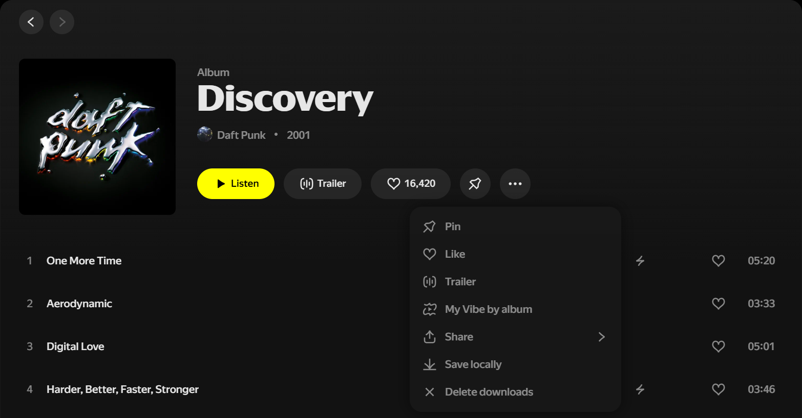
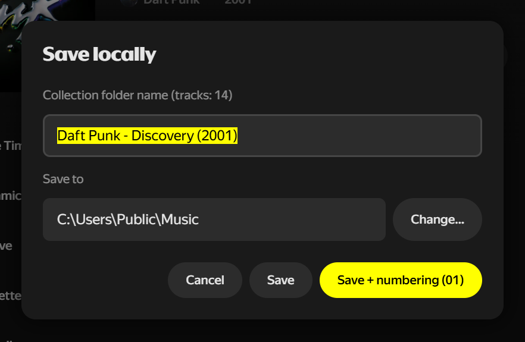
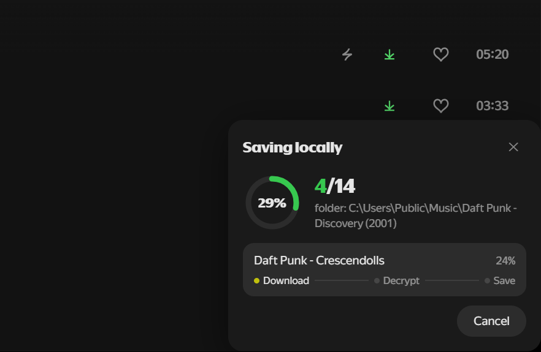
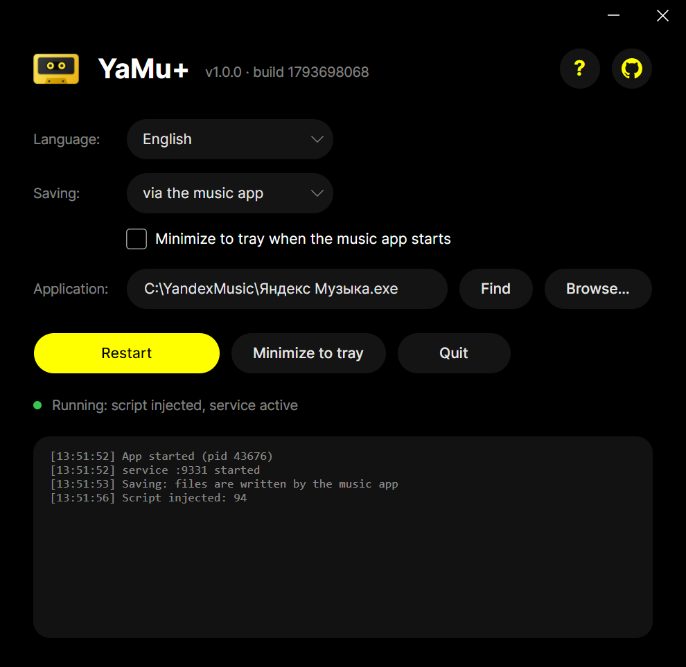

  

<h1 align="center">YaMu+</h1>

  Save tracks, albums and playlists from the Yandex Music desktop app to regular files

  
  

  <a href="README.md">Русский</a> · <b>English</b>

  

## Features

- **Track to a file.** "Save locally" in a track's ⋯ menu.
- **Album, single or playlist to a folder.** The same in a collection's ⋯ menu, with optional track numbering.
- **Cleanup.** "Delete downloads" removes the collection's tracks downloaded inside the music app.

<table>
  <tr>
    <td width="50%"></td>
    <td width="50%"></td>
  </tr>
  <tr>
    <td align="center">Folder name and destination</td>
    <td align="center">Progress right inside the music app</td>
  </tr>
</table>

## Installation

1. Download YaMu+ with the buttons above or from [Releases](https://github.com/YaMuPlus/YaMuPlus/releases). The macOS version is for Apple Silicon.
2. Install Yandex Music from the official website if you do not have it yet; the Microsoft Store version is not supported.
3. macOS: open `YaMuPlus-macos-arm64.dmg` and drag YaMu+ to Applications. YaMu+ is not notarized by Apple, so macOS will not open it the first time:
   - macOS 15 and later: “Apple could not verify ‘YaMu+’ is free of malware…”. Click Done, open System Settings → Privacy & Security, click Open Anyway next to YaMu+ under Security and confirm with your password or Touch ID.
   - macOS 12–14: “‘YaMu+’ can’t be opened because Apple cannot check it for malicious software.” Click OK, then Control-click YaMu+ in Applications, choose Open and confirm.

   After that YaMu+ opens as usual. On any version you can instead run this once in Terminal: `xattr -cr "/Applications/YaMu+.app"`.

## Usage

Open YaMu+ and click Launch: the music app opens with the new menu items.

  

<b>Building from source</b>

Each script builds both releases, `dist/YaMuPlus-windows-x64.exe` and `dist/YaMuPlus-macos-arm64.dmg`:

| System | With .NET SDK 9+ installed | Without .NET, in Docker |
|---|---|---|
| Windows | `powershell -ExecutionPolicy Bypass -File build.ps1` | `powershell -ExecutionPolicy Bypass -File build-docker.ps1` |
| macOS, Linux | `./build.sh` | `./build-docker.sh` |

Releases are built by GitHub Actions with the same `build-docker.sh` (`.github/workflows/release.yml`): bump `<Version>` in `src/YaMuPlus.csproj` and push a tag with the same version, for example `v1.0.1`.

