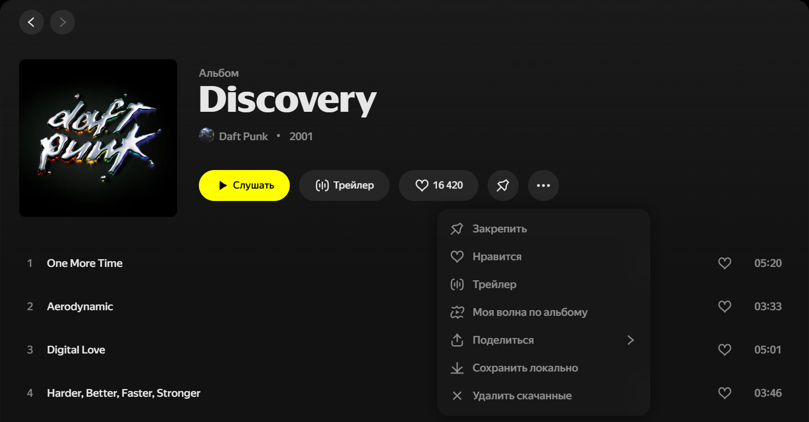
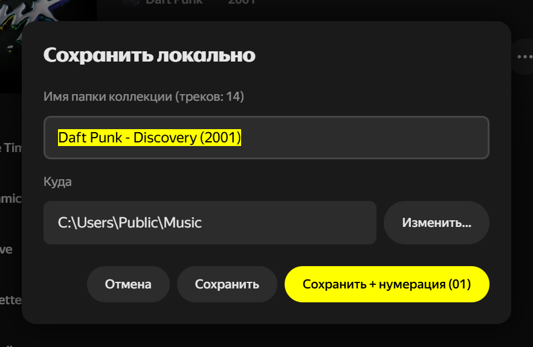
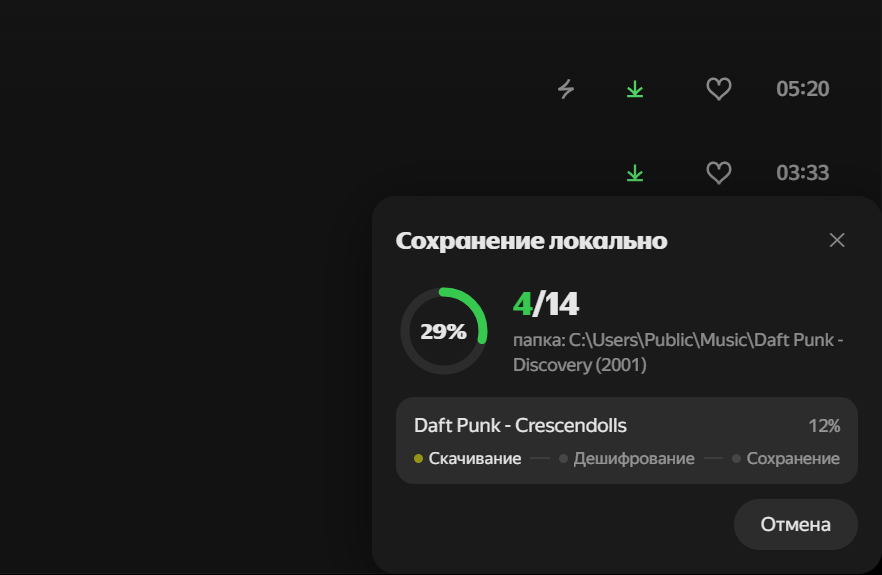
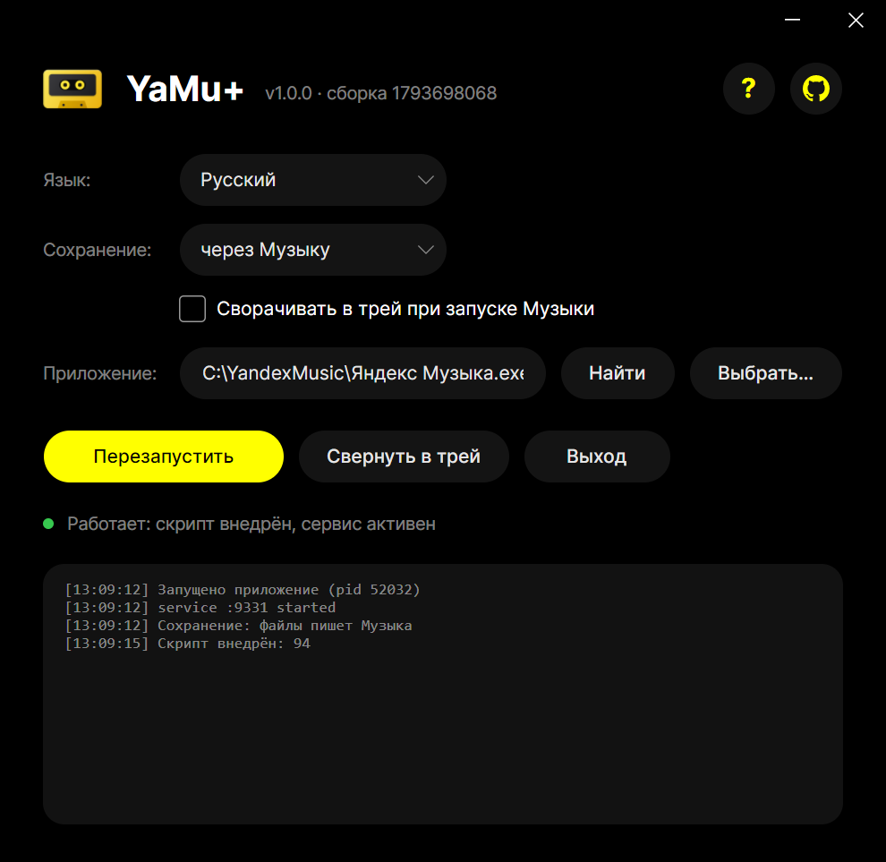

  

<h1 align="center">YaMu+</h1>

  Сохранение треков, альбомов и плейлистов из десктопной Яндекс Музыки в обычные файлы

  
  

  <b>Русский</b> · <a href="README.en.md">English</a>

  

## Возможности

- **Трек в файл.** «Сохранить локально» в меню ⋯ трека.
- **Альбом, сингл или плейлист в папку.** То же в меню ⋯ коллекции, по желанию с нумерацией треков.
- **Очистка.** «Удалить скачанные» убирает треки коллекции, скачанные в самой Музыке.

<table>
  <tr>
    <td width="50%"></td>
    <td width="50%"></td>
  </tr>
  <tr>
    <td align="center">Имя папки и место сохранения</td>
    <td align="center">Ход сохранения прямо в Музыке</td>
  </tr>
</table>

## Установка

1. Скачайте YaMu+ кнопкой выше или из [Releases](https://github.com/YaMuPlus/YaMuPlus/releases). Версия для macOS — для Apple Silicon.
2. Установите Яндекс Музыку с официального сайта, если её ещё нет; версия из Microsoft Store не поддерживается.
3. macOS: откройте `YaMuPlus-macos-arm64.dmg` и перетащите YaMu+ в «Программы». YaMu+ не нотаризована Apple, поэтому в первый раз macOS её не откроет:
   - macOS 15 и новее — окно «Apple не удалось подтвердить, что файл „YaMu+“ не содержит вредоносного ПО…». Нажмите «Готово», откройте «Системные настройки» → «Конфиденциальность и безопасность», в разделе «Безопасность» нажмите «Все равно открыть» напротив YaMu+ и подтвердите паролем или Touch ID.
   - macOS 12–14 — окно «…невозможно открыть, так как Apple не может проверить его на наличие вредоносного ПО». Нажмите «ОК», затем в «Программах» щёлкните YaMu+ правой кнопкой, выберите «Открыть» и подтвердите.

   Дальше YaMu+ открывается как обычно. На любой версии вместо этого можно один раз выполнить в Терминале: `xattr -cr "/Applications/YaMu+.app"`.

## Запуск

Откройте YaMu+ и нажмите «Запустить»: Музыка откроется уже с новыми пунктами меню.

  

<b>Сборка из исходников</b>

Любой из скриптов собирает оба релиза — `dist/YaMuPlus-windows-x64.exe` и `dist/YaMuPlus-macos-arm64.dmg`:

| Система | С установленным .NET SDK 9+ | Без .NET, в Docker |
|---|---|---|
| Windows | `powershell -ExecutionPolicy Bypass -File build.ps1` | `powershell -ExecutionPolicy Bypass -File build-docker.ps1` |
| macOS, Linux | `./build.sh` | `./build-docker.sh` |

Релиз собирает GitHub Actions тем же `build-docker.sh` (`.github/workflows/release.yml`): поднять `<Version>` в `src/YaMuPlus.csproj` и отправить тег с той же версией, например `v1.0.1`.

